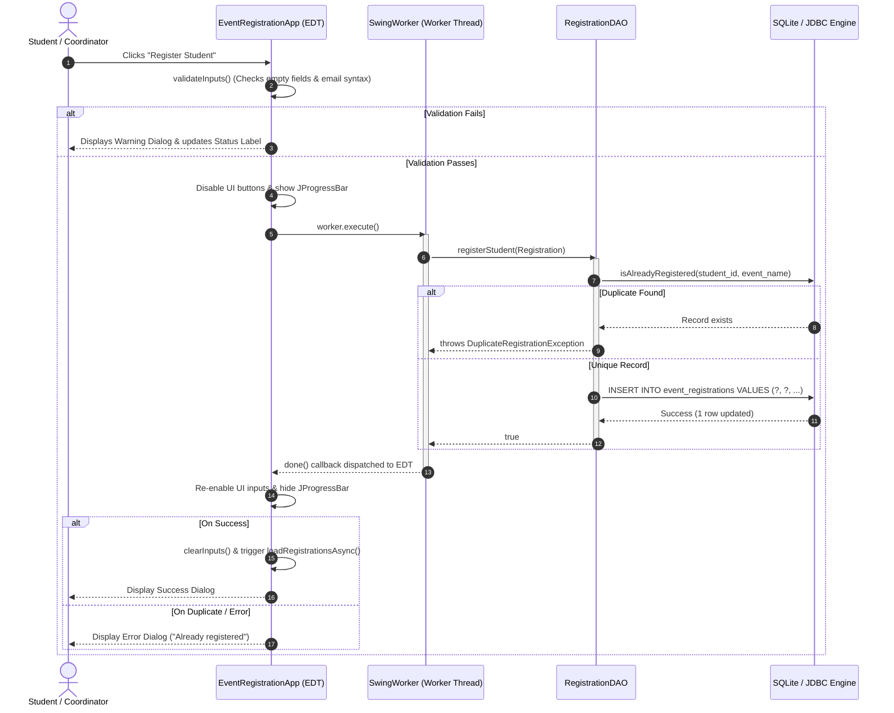

# Task 06: Campus Event Registration Desktop Application (Swing & JDBC)

## Stage 1: Interpret the Problem

### 1. User Roles
- **Students:** Enter credentials (Student ID, Name, University Email) and register for campus technical competitions, workshops, and symposiums.
- **Event Coordinators / Admins:** Review live attendee rosters, filter registrants by specific event tracks, trigger refreshes, and export registration audits to CSV.

### 2. Core Screens & Components
- **Top Menu Bar (`JMenuBar`):** `File` (Export to CSV, Exit) and `Help` (About).
- **Left Panel (Registration Entry Form):**
  - Input fields for Student ID, Full Name, Email Address.
  - Event choice dropdown (`JComboBox`).
  - Action buttons: "Register Student" and "Clear Form".
- **Right Panel (Catalog & Filter View):**
  - Filter by event dropdown with immediate reactive table update.
  - Refresh button.
  - Interactive, sortable, read-only `JTable` embedded in `JScrollPane`.
- **Bottom Status Bar:** Live status indicators and an indeterminate `JProgressBar` reflecting background worker threads.

### 3. Business Rules
1. **Mandatory Fields:** All fields (ID, Name, Email, Event) must be non-empty and non-blank.
2. **Email Syntax:** Input email must contain standard format tokens (`@` and `.`).
3. **Strict Duplicate Prevention:** A student cannot register more than once for the same event (`UNIQUE(student_id, event_name)`). However, a student is permitted to register for distinct different events.
4. **EDT Responsiveness:** All database persistence and queries must execute off the Event Dispatch Thread via `SwingWorker`.

---

## Stage 2: Screen and Event Flow

### ASCII Wireframe
```text
+------------------------------------------------------------------------------------------+
| Campus Event Registration Management System - [File | Help]                               |
+------------------------------------------------------------------------------------------+
|  STUDENT REGISTRATION FORM              |  ACTIVE REGISTRATIONS CATALOG                  |
|                                         |                                                |
|  Student ID   : [ 21BCE1001         ]   |  Filter by Event: [ All Events            |v]  |
|  Full Name    : [ Alice Smith       ]   |                   [ Refresh ]                  |
|  Email        : [ alice@univ.edu    ]   +------------------------------------------------+
|  Select Event : [ Annual Hackathon v]   | Reg ID | Student ID | Name  | Event   | Date   |
|                                         |--------+------------+-------+---------+--------|
|  [ Register Student ] [ Clear Form ]    | REG-01 | 21BCE1001  | Alice | Hack26  | 10:15  |
|                                         | REG-02 | 21BCE2002  | Bob   | Robo26  | 10:20  |
|                                         |                                                |
+------------------------------------------------------------------------------------------+
| Status: Success: Registered Alice for Annual Hackathon 2026.       [ Progress Bar: === ] |
+------------------------------------------------------------------------------------------+
```

### Event Flow Diagram


---

## Stage 3: Critical Design Decisions
1. **Input Validation Strategy:** Client-side validation is executed immediately on the EDT prior to spawning worker threads. This provides instant feedback for empty strings or invalid email syntax without wasting thread pool or database connection resources.
2. **Duplicate Prevention (Two-Tier Architecture):**
   - *Database Tier:* The schema enforces an ACID-compliant unique constraint: `CONSTRAINT unique_student_event UNIQUE (student_id, event_name)`.
   - *Application Tier:* `RegistrationDAO.isAlreadyRegistered()` verifies state before insertion, throwing a custom `DuplicateRegistrationException`.
3. **EDT Fluidity via `SwingWorker`:**
   - GUI operations (`setText`, `setEnabled`, `JOptionPane`) stay strictly on the EDT.
   - JDBC connections, SQL executions, and simulated network roundtrips run inside `SwingWorker.doInBackground()` on background worker threads.
   - Results are delivered safely back to the EDT via `SwingWorker.done()`.

---

## Stage 4: Classes and Handlers (SIMATS Pseudocode)

### Registration Handler
```text
ALGORITHM HandleRegistration():
    IF NOT validateInputs() THEN
        RETURN
    END IF

    newReg <- CREATE Registration(studentId, name, email, selectedEvent)
    DISABLE_UI_INPUTS()
    START_PROGRESS_SPINNER()

    EXECUTE_ASYNC(
        BACKGROUND_TASK:
            TRY
                RETURN dao.registerStudent(newReg)
            CATCH DuplicateRegistrationException e
                RECORD_ERROR("Student already registered for this event.")
                RETURN FALSE
            END TRY
        ON_COMPLETION(success):
            ENABLE_UI_INPUTS()
            STOP_PROGRESS_SPINNER()
            IF success THEN
                CLEAR_INPUTS()
                TRIGGER loadRegistrationsAsync()
                SHOW_SUCCESS_DIALOG()
            ELSE
                SHOW_ERROR_DIALOG(ERROR_MESSAGE)
            END IF
    )
END ALGORITHM
```

### Event Filtering Handler
```text
ALGORITHM FilterRegistrations():
    selectedFilter <- filterCombo.getSelectedItem()
    START_PROGRESS_SPINNER()

    EXECUTE_ASYNC(
        BACKGROUND_TASK:
            RETURN dao.getRegistrations(selectedFilter)
        ON_COMPLETION(recordsList):
            STOP_PROGRESS_SPINNER()
            CLEAR_TABLE_MODEL()
            FOR EACH r IN recordsList DO
                TABLE_MODEL.ADD_ROW(r.toTableRow())
            END FOR
            STATUS_LABEL.SET_TEXT("Loaded " + recordsList.size() + " records.")
    )
END ALGORITHM
```

---

## Stage 5: Verification & Alternative Concept Exploration

### Verification Results
Automated test suite (`EventRegistrationTest`) verified all 7 core functional requirements:
- Form validation catches empty fields and malformed email strings.
- Valid registrations persist correctly.
- Attempting to register the same student for the same event throws `DuplicateRegistrationException` and is blocked.
- Registering the same student for a different event succeeds.
- Filtering correctly subsets catalog rows.
- Full catalog export to CSV produces well-formed, comma-separated audit files.

### Alternative Concept: Bulk Loading 100,000 Records vs Pagination (`LIMIT`/`OFFSET`)

| Metric / Aspect | Bulk Loading Entire Dataset (100,000 Records) | Keyset / Offset Pagination (`LIMIT ? OFFSET ?`) |
|---|---|---|
| **Client Memory Footprint** | Massive: 100,000 table model rows and strings $\approx$ 150–250 MB on JVM heap. High garbage collection overhead. | Constant: Only 25–50 active viewport rows loaded $\approx$ < 100 KB on heap. |
| **Initial Screen Render Latency** | High: 3,000–8,000 ms to stream, parse, and instantiate 600,000 cell objects. Stutters UI. | Instantaneous: 20–50 ms to fetch and display the first page. |
| **Network & DB Bandwidth** | Exhausts network bandwidth and locks DB read cursor for long queries. | Minimal network packets; scalable across millions of database records. |
| **User Experience** | Desktop scrollbar is unwieldy; dragging jumps across thousands of rows. | Clean Next/Previous navigation with page jumpers. |
